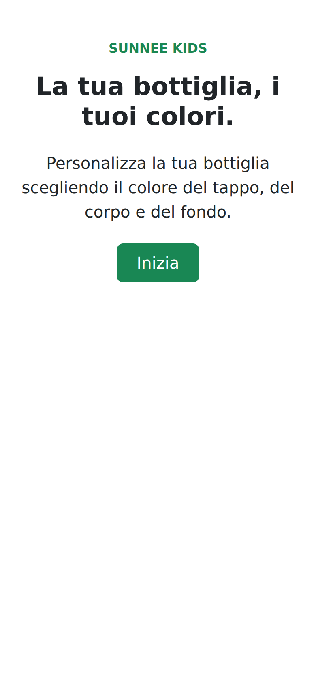
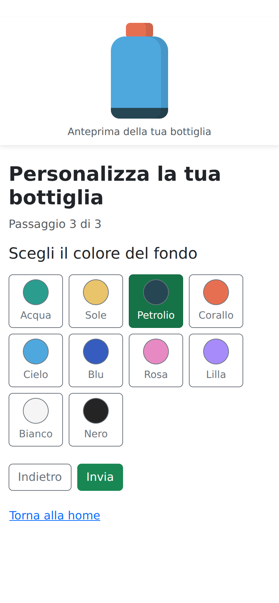
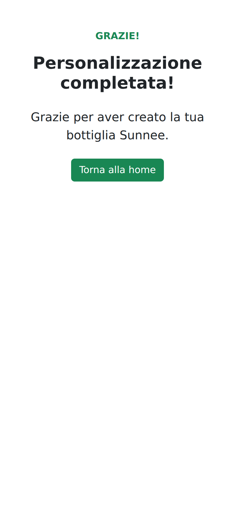
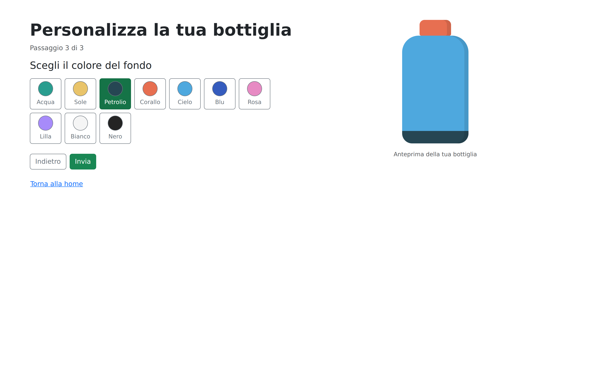

# 🌊 Sunnee Kids — Configuratore bottiglia

Un configuratore interattivo realizzato per il progetto **Vue.js 2 di start2impact**. L'utente personalizza una bottiglia termica scegliendo il colore del tappo, del corpo e del fondo attraverso tre passaggi.


## 🔗 Collegamenti

- **[Demo live](https://melvinrosales.com/sunnee-vue/#/)**
- **[Repository GitHub](https://github.com/rack09/sunnee-vue)**
- **[Presentazione PDF](docs/Progetto_Vuejs_2_di_Melvin_Rosales.pdf)**

## 🎯 Il progetto

Sunnee è il brand ipotetico di costumi sostenibili descritto nel brief del corso. Per il lancio della linea Kids, il primo ordine include una bottiglia termica personalizzabile. Questa applicazione realizza il configuratore della bottiglia.

## ✨ Funzionalità

- **10 colori predefiniti**, con nome e campione visivo.
- **3 passaggi:** tappo, corpo e fondo.
- Anteprima aggiornata quando viene selezionato un colore.
- Pulsanti **Avanti** e **Indietro**, con conservazione delle scelte tra i passaggi.
- Colore corrente evidenziato nel selettore.
- Pulsante **Invia** disponibile nell'ultimo passaggio.
- Pagina iniziale e pagina di ringraziamento.
- Anteprima a destra su desktop; compatta, sopra i controlli e fissa durante lo scorrimento su mobile.
- Pulsanti utilizzabili con la tastiera e stato di selezione esposto tramite `aria-pressed`.

## 📱 Anteprima mobile

Schermate della demo pubblicata, renderizzate con un viewport mobile emulato di **390 × 844 px**.

<table>
  <tr>
    <th>Benvenuto</th>
    <th>Configuratore</th>
    <th>Ringraziamento</th>
  </tr>
  <tr>
    <td></td>
    <td></td>
    <td></td>
  </tr>
</table>

Su mobile l'anteprima viene mostrata sopra i controlli e rimane visibile durante lo scorrimento grazie a `position: sticky`.

## 🖥️ Anteprima desktop



## 🧩 Struttura e responsabilità

Il progetto usa **6 componenti `.vue`**, ciascuno con una responsabilità precisa.

| Componente | Responsabilità |
| --- | --- |
| `src/App.vue` | Ospita `RouterView`, che mostra la schermata associata alla rotta corrente. |
| `src/views/BenvenutoView.vue` | Presenta il configuratore e permette di iniziare. |
| `src/views/ConfiguratoreView.vue` | Gestisce lo stato dei colori, il passaggio corrente e la navigazione del percorso. |
| `src/components/SelettoreColori.vue` | Riceve una paletta e il colore corrente; comunica la scelta tramite l'evento `seleziona`. |
| `src/components/AnteprimaBottiglia.vue` | Riceve i tre colori tramite props e disegna l'anteprima con HTML e CSS. |
| `src/views/GrazieView.vue` | Conferma il completamento del percorso e consente di tornare alla pagina iniziale. |

Un solo selettore viene riutilizzato per tutte le parti della bottiglia. Il configuratore decide quale proprietà aggiornare, evitando di duplicare componenti e funzioni per tappo, corpo e fondo.

## ⚙️ Stato ed eventi

`coloriBottiglia` è un `ref` che contiene i colori delle tre parti. `passoAttuale` identifica il passaggio corrente; `parteAttuale` e `ultimoPasso` sono proprietà `computed` derivate da questo stato.

Il flusso di una selezione è il seguente:

1. L'utente preme un pulsante in `SelettoreColori`.
2. Il selettore esegue `emit('seleziona', colore.hex)`.
3. `ConfiguratoreView` intercetta l'evento con `@seleziona="aggiornaColore"`.
4. `aggiornaColore` modifica la proprietà corrispondente al passaggio corrente.
5. Le props di `AnteprimaBottiglia` ricevono i nuovi valori e `:style` aggiorna i colori.

```javascript
function aggiornaColore(colore) {
  coloriBottiglia.value[parteAttuale.value] = colore
}
```

La bottiglia è composta da tre elementi HTML, colorati con `backgroundColor`. Gli stili specifici sono racchiusi nei componenti tramite `<style scoped>`, mentre Bootstrap gestisce contenitori, colonne, pulsanti e spaziature.

Le scelte rimangono disponibili passando avanti e indietro all'interno del configuratore. Lo stato vive nel componente: una ricarica della pagina lo riporta ai valori iniziali. **Invia** completa il percorso frontend e apre il ringraziamento; l'applicazione non genera un ordine commerciale.

## 🚀 Avvio in locale

È necessario avere Node.js e npm compatibili con la versione di Vite indicata nel progetto.

Clonare il repository e installare le dipendenze usando il lockfile:

```bash
git clone https://github.com/rack09/sunnee-vue.git
cd sunnee-vue
npm ci
```

Avviare il server di sviluppo:

```bash
npm run dev
```

Aprire l'indirizzo indicato dal terminale. In Windows PowerShell gli stessi comandi possono essere eseguiti con `npm.cmd`.

## 📦 Build e anteprima

```bash
npm run build
npm run preview
```

Il primo comando genera i file di produzione nella cartella `dist`; il secondo permette di controllarli con un server locale.

## 🌐 Pubblicazione in una sottocartella

La demo è disponibile su **[melvinrosales.com/sunnee-vue/#/](https://melvinrosales.com/sunnee-vue/#/)**.

Per rigenerare la build destinata alla sottocartella `/sunnee-vue/`, impostare questa proprietà in `vite.config.js`, conservando gli altri campi:

```javascript
base: '/sunnee-vue/',
```

Il router usa già questa impostazione:

```javascript
history: createWebHashHistory(import.meta.env.BASE_URL)
```

Dopo aver impostato `base`, eseguire nuovamente `npm run build` e caricare il **contenuto** di `dist` nella sottocartella `sunnee-vue` del dominio. `index.html` deve trovarsi direttamente in quella cartella.

La rotta del configuratore è `/sunnee-vue/#/configuratore`; quella di ringraziamento è `/sunnee-vue/#/grazie`.

Il modo hash permette al router di gestire la parte dopo `#` nel browser. La proprietà `base` permette a Vite di generare le corrette posizioni dei file statici.

## ✅ Controlli prima della consegna

- Eseguire `npm run build`.
- Scegliere colori diversi per tappo, corpo e fondo.
- Tornare indietro e controllare sia l'anteprima sia il colore evidenziato.
- Verificare il passaggio alla pagina di ringraziamento con **Invia**.
- Controllare che su mobile l'anteprima rimanga visibile durante la selezione.
- Controllare l'uso dei pulsanti con la tastiera.

Il progetto non include uno script `npm test`: i comandi disponibili sono `dev`, `build` e `preview`.

## 👤 Autore

**Melvin Rosales** · Master Full Stack Development · start2impact.
